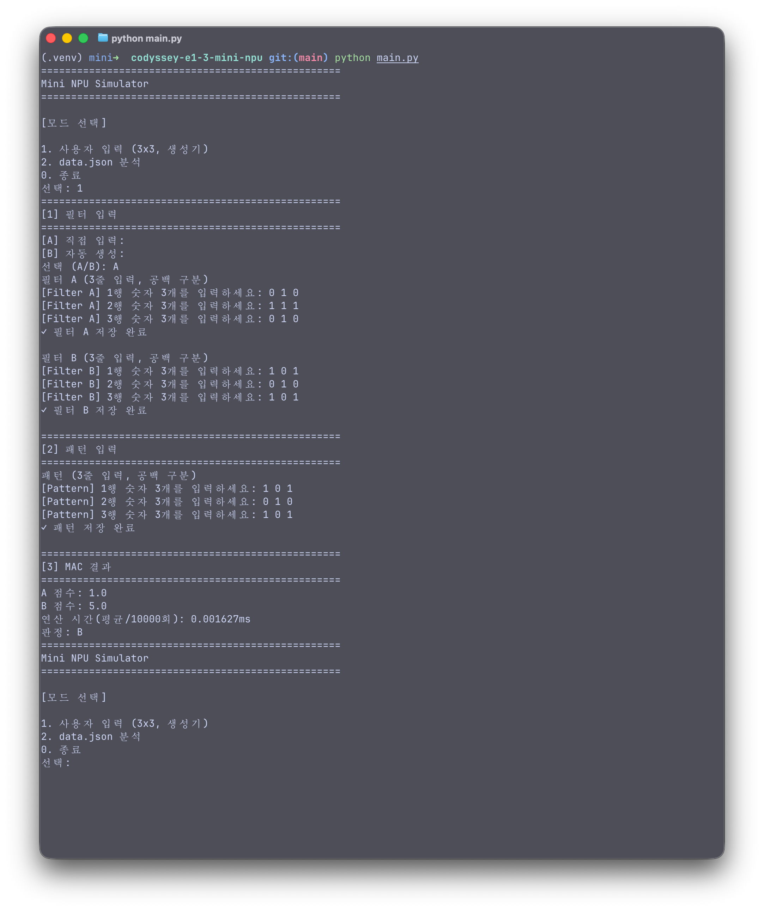
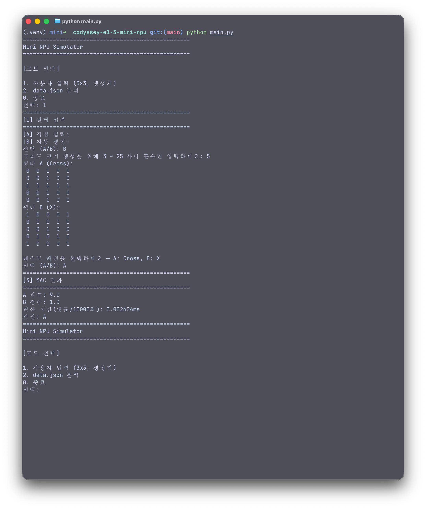
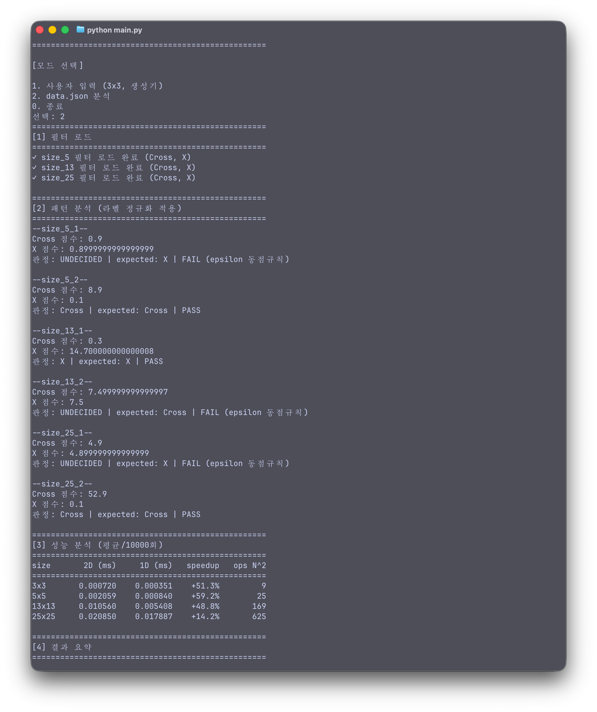
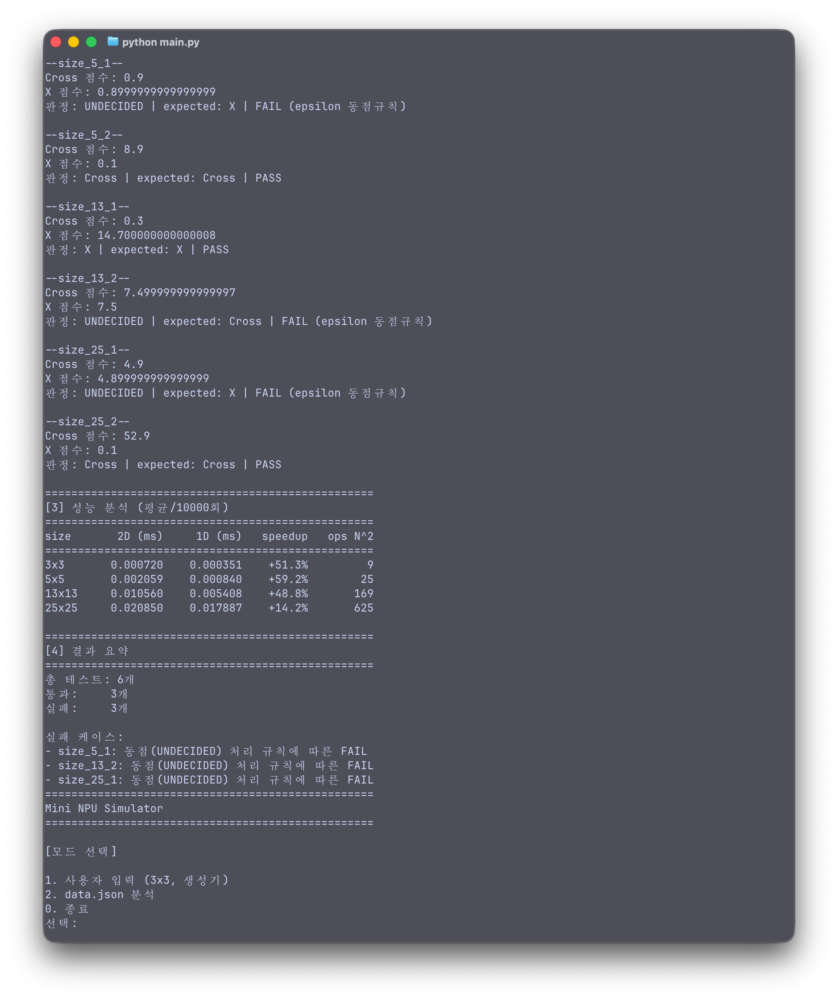
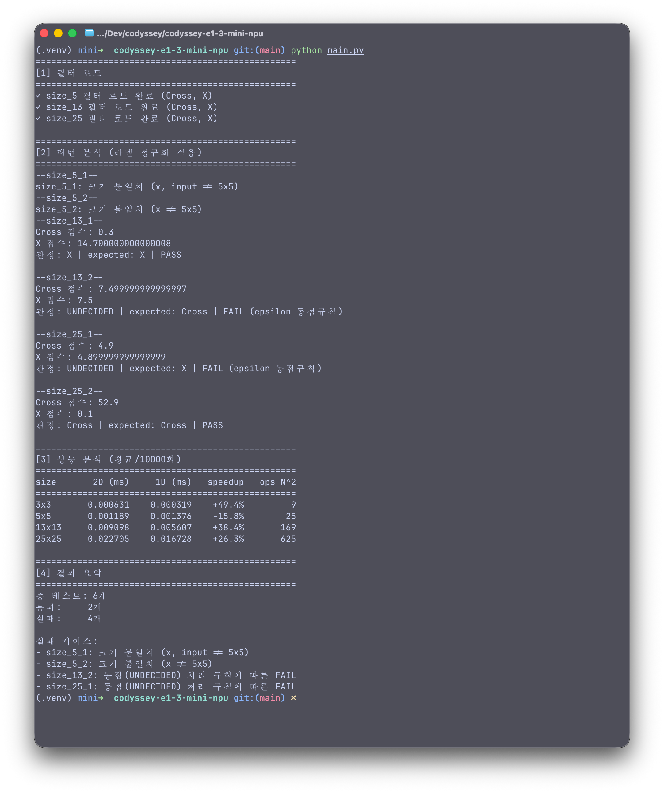
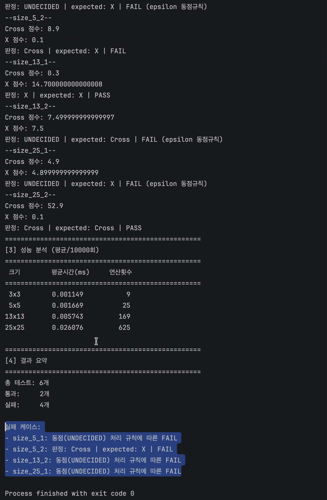
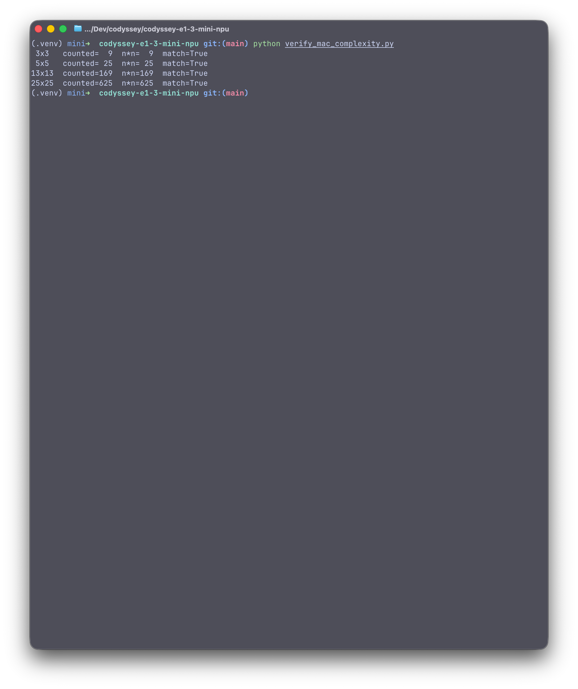
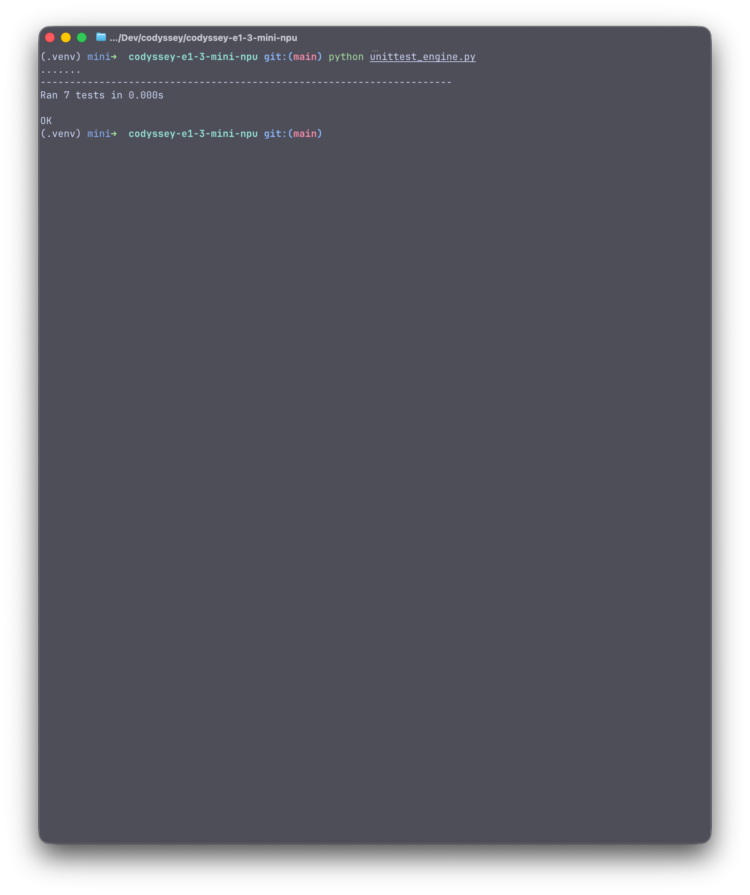

# Mini NPU Simulator (MAC 연산 계산기)

경남 코디세이 AI 올인원 **Mission E1-3**  
AI가 계산하는 방식인 **MAC 연산(Multiply-Accumulate)** 을
직접 반복문으로 구현한 터미널 프로그램입니다.   
n×n 패턴을 n×n 필터에 겹쳐 위치별로 곱하고 전부 더해
**유사도 점수**를 내고 두 필터 중 어느 쪽에 더 가까운지(Cross / X / 판정 불가)를 가립니다.

> 이 README는 리뷰어와 작성자 모두에게 교육적으로 쓸모 있도록 구성했습니다. **미션 요구 항목(실행·기능·결과
> 리포트)을 앞에 두고**, 그 뒤에 **핵심 개념 설명**과 **구현 노트**를 자세히 덧붙입니다. NumPy 없이 순수
> 반복문으로 구현했고, 표준 라이브러리(`json`, `time`, `unittest`)만 사용합니다.

---

## 1. 프로젝트 개요

하나의 콘솔 프로그램 안에서 다음을 통합 연습합니다.

- **MAC 연산 직접 구현** — 위치별 곱 + 전부 합산을 **반복문으로** (NumPy/pandas 금지).
- **두 가지 입력 모드** — (1) 사용자 키보드 입력(3×3), (2) `data.json` 일괄 분석(5/13/25).
- **라벨 정규화** — `'+'`/`'cross'` → Cross, `'x'` → X 로 여러 표기를 하나의 표준 어휘로 통일.
- **부동소수점 epsilon 비교** — `abs(a-b) < 1e-9` 이면 동점(UNDECIDED). `data.json`의 `0.9` 값들이
  의도적으로 이 상황을 만듭니다.
- **성능 분석** — 크기별 평균 시간(ms) 측정 → **시간 복잡도 O(N²)** 근거 제시.
- **스키마/크기 검증** — 잘못된 데이터에도 **프로그램이 멈추지 않고** 해당 케이스만 FAIL 처리.
- **보너스 2종 (모두 구현)** — ① 2차원 → 1차원 변환 최적화 + 전/후 성능 비교, ② 크기 N의 Cross/X
  패턴 생성기(모드 1에 재활용).

---

## 2. 실행 방법

```bash
python main.py
```

- **Python 3.8 이상**, **외부 라이브러리 없음** (표준 라이브러리만).
- 실행하면 **모드 선택 메뉴**가 뜹니다: `1` 사용자 입력 · `2` data.json 분석 · `0` 종료.
- `data.json`은 프로젝트 루트에 있어야 합니다(UTF-8). 모드 2가 이 파일을 읽습니다.
- `Ctrl+C` / `EOF`(Ctrl+D)는 traceback 없이 **우아하게 종료**됩니다(§8.5).

**엔진/보너스 스크립트 단독 실행:**

```bash
python verify_mac_complexity.py   # 연산 횟수가 N²와 일치하는지 실측 증명
python unittest_engine.py         # 엔진(mac/judge) 단위 테스트
```

---

## 3. 기능 및 실행 화면

### 모드 1 — 사용자 입력 (3×3)

필터 입력 방식을 먼저 고릅니다: **[A] 직접 입력** 또는 **[B] 자동 생성**(보너스 2).

**[A] 직접 입력** — 필터 A·B·패턴을 "한 줄씩(공백 구분)"으로 받아 저장 확인 후 MAC → 판정(A/B/판정 불가)
→ 연산 시간(ms)을 출력합니다. 행/열 개수 불일치·숫자 아님은 안내 후 **재입력**을 유도합니다.



**[B] 자동 생성 (보너스 2)** — 크기 N(3~25 홀수)을 입력하면 N×N **Cross/X 필터를 생성**해 그대로 MAC에
투입합니다. 테스트 패턴도 생성해 분류하므로 "Cross 패턴 → 판정 A(Cross)"가 **스스로 검증**됩니다.



### 모드 2 — data.json 분석

필터 로드(✓) → 케이스별 `Cross 점수`/`X 점수`/`판정 | expected | PASS·FAIL` → **[3] 성능 분석 표**
→ **[4] 결과 요약**(총/통과/실패 + 실패 목록) 순으로 진행합니다.




---

## 4. 결과 리포트 (미션 필수)

### 4.1 실패 원인 분석 — 세 범주로 진단

미션은 실패를 **데이터/스키마 vs 로직 vs 수치 비교**로 분리 진단할 것을 요구합니다. 이 프로그램이
구별하는 네 종류의 실패를 그 세 범주에 대응시키면 다음과 같습니다.

| 실패 종류 | 범주 | 원인 |
|---|---|---|
| `크기 불일치` (필터·입력 shape 불일치) | **데이터/스키마** | 데이터가 N×N 스키마를 위반 |
| `데이터 오류` (키 누락·타입 오류) | **데이터/스키마** | 구조 자체가 손상 |
| `오판정` (margin은 분명한데 틀림) | **로직** | 계산은 깨끗이 돌았으나 결과가 기대와 반대 |
| `epsilon 동점` (UNDECIDED) | **수치 비교** | 점수가 너무 가까워 float 허용오차로 동점 처리 |

**핵심 구분:** *분명하게 틀린 답*은 로직, *너무 비슷해 못 가리는 것*은 수치 — 정반대 끝입니다.
`오판정`은 epsilon 사례가 아닙니다(margin이 사라진 게 아니라, margin이 있는데 방향이 반대).

**실제 `data.json` 결과 — 총 6, 통과 3, 실패 3 (모두 epsilon 동점):**

| 케이스 | Cross | X | 판정 | expected | 결과 |
|---|---|---|---|---|---|
| size_5_1 | `0.9` | `0.8999999999999999` | UNDECIDED | X | **FAIL (수치)** |
| size_5_2 | `8.9` | `0.1` | Cross | Cross | PASS |
| size_13_1 | `0.3` | `14.700000000000008` | X | X | PASS |
| size_13_2 | `7.499999999999997` | `7.5` | UNDECIDED | Cross | **FAIL (수치)** |
| size_25_1 | `4.9` | `4.899999999999999` | UNDECIDED | X | **FAIL (수치)** |
| size_25_2 | `52.9` | `0.1` | Cross | Cross | PASS |

→ **세 실패는 모두 "수치 비교(epsilon 동점)" 범주**입니다. 로직 버그도, 데이터 손상도 아닙니다. `data.json`이
일부러 `0.9`/`0.1` 같은 값을 넣어 두 점수를 극단적으로 가깝게 만들었고(`0.9` vs `0.8999…`), `1e-9` 허용오차
안에 들어오면 정책상 UNDECIDED 처리되어 `expected`와 어긋나기 때문입니다. **의도된 함정이며, 올바른 동작**
입니다(§6.4).

**나머지 두 범주는 고의 오류 입력 fixture로 검증했습니다:**

- **크기 불일치(데이터/스키마):** `data_error_mod.json`에서 `size_5` x필터 한 행을 지워 4×5로 만들면,
  해당 케이스만 `크기 불일치 (x, input != 5x5)`로 FAIL 처리하고 **나머지 케이스는 정상 진행**합니다
  (중단 금지). 총계도 어긋나지 않습니다(총 = 통과 + 실패).

  

- **오판정(로직):** `data_expected_mod.json`에서 어떤 케이스의 `expected`를 뒤집으면, 분명한 승자가
  기대와 반대가 되어 `판정: Cross | expected: X | FAIL`로 기록됩니다(실제 `data.json`에는 이 사례가 없어
  fixture로만 재현).

  

### 4.2 시간 복잡도 분석 — O(N²)

MAC은 N×N 격자의 **모든 칸을 한 번씩** 방문합니다. 즉 바깥 N행 × 안쪽 N열 = **N²번의 곱셈-누산**.
따라서 시간 복잡도는 **O(N²)** 이고, N을 2배로 키우면 연산량은 약 4배가 됩니다.

**연산 횟수 = N²임을 실측 증명:** `verify_mac_complexity.py`는 같은 중첩 루프를 돌며 **실제 반복 횟수를
세고**, 그 값을 공식 `n*n`과 나란히 찍어 `match=True`를 확인합니다. 주장이 아니라 증거입니다.



**크기별 평균 시간 측정([3] 성능 분석) — 반복수(REPS)에 대하여:** 미션은 "**최소** 크기별 10회 반복 후
평균"을 요구합니다(10회는 하한/최솟값). 그런데 서브-마이크로초 연산(3×3은 약 0.0007ms)은 10회 같은
소수 반복으로 재면 `perf_counter` 분해능에 묻혀 **0이나 큰 노이즈**가 됩니다. 그래서 요구 최솟값을 크게
초과하는 **`REPS = 10_000`회로 상향**해, 총합을 누적한 뒤 횟수로 나눠(총합÷횟수) 서브-마이크로초 정밀도를
회복했습니다 — **최소 10회 요구를 충족하고도 남습니다.** 각 크기마다 `time.perf_counter()`로 측정하며,
I/O는 제외하고 "연산 함수 호출 구간"만 잽니다.

| size | 2D (ms) | 1D (ms) | speedup | ops N² |
|---|---|---|---|---|
| 3×3 | 0.000720 | 0.000351 | +51.3% | 9 |
| 5×5 | 0.002059 | 0.000840 | +59.2% | 25 |
| 13×13 | 0.010560 | 0.005408 | +48.8% | 169 |
| 25×25 | 0.020850 | 0.017887 | +14.2% | 625 |

시간이 N²(연산 횟수) 증가에 따라 커지는 것이 관찰됩니다 — O(N²)의 경험적 근거입니다. `speedup` 열은
보너스 1(1차원 최적화)의 전/후 비교이며 §6.5에서 설명합니다. **측정 노이즈 주의:** 작은 n에서는 실제
차이가 수백 ns에 불과해 단발 측정의 지터에 묻혀 **부호가 음수로 뒤집히기도 합니다**(예: 다른 실행에서
5×5가 −15.8%). 버그가 아니라 마이크로벤치마크의 본질이며, 안정화하려면 여러 번 측정해 최소값을 취하면
됩니다(noise는 시간을 더하기만 하므로 최소값이 참값에 가장 가까움).

---

## 5. 핵심 개념 — "스스로 설명할 수 있어야 하는 것"

> 미션 §3가 요구하는 개념들을 직접 정리했습니다. 각 항목 끝에 한 줄 요약(핵심)을 둡니다.

### 5.1 내적(dot product) — 모든 것의 토대

길이가 같은 두 수열을 **같은 자리끼리 곱한 뒤 모두 더한** 하나의 수입니다.

```
a · b = a₁b₁ + a₂b₂ + … + aₙbₙ = Σ aᵢbᵢ
예) [1,0,1] · [1,1,0] = (1·1)+(0·1)+(1·0) = 1
```

**무엇을 재는가: 두 수열이 얼마나 "겹치는가(정렬되는가)".** 같은 자리에 둘 다 큰 값이면 큰 내적(일치),
한쪽이 0인 자리는 0을 기여(불일치). **0/1 수열에서는 둘 다 1인 자리의 개수 = 겹침(overlap)** 입니다.
(기하적으로는 `a·b = |a||b|cosθ` — 같은 방향이면 최대, 수직이면 0.)

> **핵심:** 내적 = 자리 맞춰 곱해 더하기 = 두 대상이 얼마나 겹치는가.

### 5.2 MAC 연산 = 내적, 그리고 NPU가 존재하는 이유

**MAC은 두 격자의 내적**입니다. 필터와 패턴을 1차원으로 펴서 칸별로 곱해 누적 — 이것이 곧
`mac_1d`의 `score += kernel[i] * pattern[i]`. 그래서 **MAC = 내적 = 유사도 점수**입니다.

실제 AI는 한 장의 이미지에 **수억 번**의 MAC을 돌리고, 각 칸의 곱은 **서로 독립**입니다. CPU는 이를
**순차적으로 하나씩** 처리하지만, **NPU는 수천 개의 곱셈-누산 유닛을 병렬**로 돌립니다. CPU가 버거운
이유는 O(N²) 라벨 자체가 아니라 **엄청난 양 + 완벽한 병렬성** 때문입니다.

> **핵심:** MAC = 필터·패턴의 내적. NPU는 그것이 수억 번이고 전부 병렬이라서 존재한다.

### 5.3 점수가 높을수록 더 잘 맞는 이유

점수가 **겹침을 세기** 때문입니다. 두 격자가 같은 자리에 1이면 `1×1=1`을 기여하고, 어긋나면 `0`을
기여합니다. 겹치는 "켜진 칸"이 많을수록 합이 커집니다. 실제 값으로:

- `mac(cross, cross) = 9` → Cross가 자기 자신과 9칸 모두 겹침.
- `mac(x, cross) = 1` → X와 Cross는 **중앙 한 칸**만 겹침.

> **핵심:** 점수는 겹침의 개수. 가장 많이 겹치는 쪽이 이긴다.

### 5.4 라벨 정규화 — 왜, 그리고 왜 맵 2개

같은 두 모양을 세 가지 "언어"가 서로 다르게 부릅니다: 필터 키 `'cross'`/`'x'`, `expected` 필드
`'+'`/`'x'`(`'+'`가 Cross!), `judge`의 위치 반환 `'a'`/`'b'`. **정규화 = 이 모두를 하나의 표준
어휘(Cross/X/UNDECIDED)로 번역**해, 프로그램과 사용자가 일관되게 소통하고 PASS/FAIL을 같은 기준으로
비교하기 위함입니다.

**맵이 2개인 이유:** `NORM_EXPECTED`는 `{+, x}`를, `NORM_VERDICT`는 `{a, b, tied}`를 번역합니다. 서로
**키가 겹치지 않는 다른 입력 알파벳**이라 하나의 dict로 합치면 충돌/누락이 납니다. 입력 언어 둘 → 번역기
둘 → 공통 출력 하나.

**정규화를 명명 함수로 노출 — `to_label` / `expected_label`:** 정규화 로직 자체는 "입력 → 표준 라벨"의
**테이블 조회**이지만, 그 조회를 `to_label(verdict)`(judge 출력 a/b/tied → 라벨)와 `expected_label(raw)`
(json `+`/`x` → 라벨)라는 **이름 있는 함수**로 감쌌습니다. 덕분에 "정규화"라는 연산이 코드에서 명시적으로
드러나고(호출부가 `to_label(result)`로 의도가 분명), 내부는 여전히 dict 한 줄이라 단순합니다. 정규화가
**단순 조회를 넘어 로직**(대소문자 통일·공백 정리·별칭 매칭 등)으로 커지면, 호출부는 그대로 둔 채 이
함수 안에서만 확장하면 됩니다 — 이것이 함수 경계를 둔 이점입니다.

**새 라벨 추가 체크리스트** (예: `Diamond` 확장 시 네 곳을 함께 손봅니다) —

1. **정규화 맵:** `NORM_EXPECTED`에 입력 표기 추가(`'d'` → `Diamond`), 필요하면 `NORM_VERDICT`도.
2. **판정(`judge`):** 현재는 두 점수(a/b) 비교. 라벨이 3개 이상이면 "최고 점수 선택" 방식으로 확장.
3. **출력:** `MODE1_VERDICT`와 콘솔 라벨 문자열에 새 표기를 추가.
4. **테스트:** 새 라벨의 생성·점수·판정 케이스를 `unittest_engine.py`에 추가.

> **핵심:** 한 모양의 여러 표기를 하나의 어휘로. 입력 알파벳이 둘이니 맵도 둘. 조회는 `to_label`/
> `expected_label` 함수로 노출하되 핵심은 테이블.

### 5.5 부동소수점, epsilon, 그리고 "0.9 함정"

**왜 epsilon이 필요한가:** 컴퓨터는 소수를 2진법으로 저장하는데 대부분의 소수는 **정확히 표현되지
않습니다**(1/3이 유한 소수가 안 되듯). 작은 반올림 오차가 누적되어, 같아야 할 두 값이 `0.9` vs
`0.8999999999999999`로 어긋납니다. 엄격한 `==`는 이를 "다르다"고 하여 **현실과 맞지 않게** 됩니다. 그래서
**허용오차**로 비교합니다: `abs(a-b) < 1e-9` 이면 동점(UNDECIDED).

**왜 `data.json`이 일부러 `0.9`를 쓰는가:**

- **`1.0`은 2진법으로 정확히 표현**되어 합도 정확 → `==`가 잘 동작하고 epsilon이 **쓰일 일이 없음**.
  float 문제가 아예 드러나지 않습니다.
- **`0.9`/`0.1`은 정확히 표현되지 않아**, 더하면 반올림 노이즈가 생깁니다(`0.9 → 0.8999999999999999`).
  바로 이 "거의 같은" 점수들이 epsilon을 **반드시 써야 하는** 상황을 만듭니다.

즉 `0.9`는 float 부정확성을 **직접 다루게 만드는 의도된 함정**입니다. 깨끗한 `1.0`만 썼다면 이 교훈
전체가 숨어 버립니다.

> **핵심:** float은 대부분의 소수를 정확히 못 담아 오차가 쌓인다 → `==` 금지, 허용오차 사용. `0.9`는
> 부정확한 값이라 오차가 실제로 드러나게 하려고 고른 것.

### 5.6 왜 MAC은 O(N²)인가

필터가 N×N이라 모든 칸 방문 = **N행 × N열 = N²칸**, 각 칸이 곱셈-누산 1회. N을 2배로 → 연산량 약 4배.
`verify_mac_complexity.py`가 실제 반복을 세어 `counted == n*n`(`match=True`)로 공식을 **실측 증명**합니다.

> **핵심:** N×N 격자 → N²칸 → O(N²). N 2배면 시간 4배.

### 5.7 크기 불일치가 왜 "조용히" 틀렸는가 (silent bug)

`mac`은 **커널(필터)의 크기**를 기준으로 루프를 돕니다(`for r in range(len(kernel))`). x필터를 4×5로
줄이면 루프는 **4행만** 돌고, 0~3행·0~4열 인덱스는 5×5 패턴에서 **모두 유효**합니다. 어떤 인덱스도 범위를
벗어나지 않으니 **IndexError가 나지 않습니다.** 패턴의 5번째 행만 조용히 무시한 채 너무 작은 점수를
돌려줍니다.

**교훈:** `try/except`는 **예외를 던지는 것만** 잡습니다. 작아진 커널은 예외를 던지지 않고 그냥 틀린 답을
줍니다. 그래서 크기 가드는 예외를 기다리는 EAFP가 아니라, **먼저 모양을 검사하는 LBYL**이어야 합니다(§6.3).

> **핵심:** 루프가 더 작은 격자에 묶여 모든 인덱스가 유효 → 크래시 없이 오답. 조용한 거짓은 `except`로
> 못 잡으니 모양을 먼저 검사해야 한다.

---

## 6. 구현 노트 — 설계와 흥미로웠던 지점

### 6.1 순수 엔진 + 추가되는 스킨 (Pure engine, additive skins)

구조의 중심 원칙입니다.

```
Layer 1  mac(kernel, pattern) -> float      두 격자 → 한 점수      (순수)
Layer 2  judge(score_a, score_b) -> str     두 점수 → 판정(a/b/tied) (순수)
Layer 3  스킨: 모드1(키보드) · 모드2(JSON) · 타이밍 · 리포트 · 생성기  (I/O + 배선)
```

- **엔진(`mac`, `judge`)은 순수 함수** — 데이터만 받아 값만 반환, 출력/파일/전역 상태 없음. 두 모드가
  공유하고 단위 테스트가 격리 검증합니다.
- **스킨은 I/O와 배선** — 모드·타이밍·성능표·요약·생성기는 모두 엔진 위에 "덧붙는" 레이어라, 새 기능을
  추가해도 코어를 고칠 필요가 없습니다. 보너스(1D 최적화·패턴 생성기)가 코어 수정 없이 붙은 이유입니다.
- **모드는 한 파일(`main.py`)에, 엔진만 분리(`mac.py`/`judge.py`):** 분리는 "기능이 다르다"가 아니라
  **재사용·테스트 경계**를 따릅니다. 엔진은 양쪽이 쓰고 격리 테스트하므로 분리할 값어치가 있지만, 모드는
  leaf consumer라 같은 레이어로 묶는 게 더 단순합니다.

### 6.2 계산과 표현의 분리 (compute vs present)

반복해서 적용한 원칙: **계산 함수는 데이터를 반환하고, 표현은 호출자가 결정한다.**

- `mac`은 `float`를 반환(출력 문자열이 아님), `judge`는 `"a"`를 반환(찍힌 줄이 아님), `benchmark`는
  ms 숫자를 반환(포맷은 호출 지점의 `.6f`).
- PASS/FAIL도 먼저 **불린(`passed = verdict == expected`)** 으로 결정하고, 라벨 문자열은 그 위에 얹습니다.
  덕분에 `passed`가 요약 집계에 그대로 재사용됩니다.

### 6.3 크기/스키마 가드 — LBYL + EAFP 두 그물

모드 2는 "스키마/크기 불일치에도 중단 금지"를 요구합니다. 실패는 두 부류라 가드도 둘입니다.

- **LBYL(먼저 검사) — 조용한 부류:** `is_n_by_n`으로 필터·입력이 선언된 N×N인지 **mac 호출 전에** 검사.
  작아진 커널은 예외를 안 던지므로(§5.7) 이것만이 잡을 수 있습니다. 불일치 → `크기 불일치` FAIL + `continue`.
- **EAFP(try/except) — 던지는 부류:** 키 누락·타입 오류·크기 키 파싱 실패는 실제로 예외를 던지므로
  **좁은** `except (KeyError, ValueError, TypeError)`로 받습니다. 맨손 `except:`는 내 코드 버그까지
  삼켜 "데이터 오류"로 위장하므로 피합니다.
- 두 실패 모두 **같은 `failed_cases` 리스트**에 사유와 함께 append → `continue`가 곧 "중단 금지" 장치.

### 6.4 `0.9` 설계 의도 — 두 가지 함정을 동시에

`0.9`는 (1) float 노이즈를 만들어 epsilon을 반드시 쓰게 하고(§5.5), (2) 0/1에서 생기는 퇴화(all-ones
필터가 이상적 필터와 무조건 동점이 되는 현상: `mac(P,P)=ΣP²=ΣP`)를 분수 가중치로 깨뜨립니다. 한 값이
두 함정을 겸합니다.

### 6.5 보너스 1 — 2차원 → 1차원 최적화

파이썬의 `list[list[float]]`은 바깥 리스트가 **흩어진 안쪽 리스트들의 참조**를 담습니다. 그래서
`grid[r][c]`는 **첨자 접근 2번**(바깥→안쪽). 1차원으로 펴면 `flat[i]`로 **1번**이 되고, 중첩 루프도
평탄한 단일 루프가 됩니다. 2D 본문 `pattern[r][c]*kernel[r][c]`는 칸당 **4번의 첨자 접근**인데, 1D는
**2번** — 지배적 작업을 절반으로 줄입니다. (단, 파이썬 float은 **박싱**되어 흩어지므로, 1D라도 C처럼
값이 연속되지는 않습니다. 첨자 1단계를 줄일 뿐.)

- **flatten은 `mac_1d` 안이 아니라 밖에서** 1번만 — 그래야 평탄화 비용이 타이밍에 포함되지 않고, 실제
  최적화 사용 방식(레이아웃을 한 번 바꾸고 많은 MAC을 돌림)과도 일치합니다.
- 인터넷에 CPython 정식 벤치마크는 없어 **방향과 메커니즘만 확인**됩니다. 크기는 작업/구현마다 다르며,
  권위 있는 증거는 **우리 자신의 측정**입니다(미션이 바라는 바). 측정값 ~14~59%는 단발 지터를 포함합니다.

### 6.6 보너스 2 — Cross/X 패턴 생성기

모든 격자 모양은 "**어떤 인덱스 관계를 만족하는 칸**"입니다.

- **Cross(`+`)** = 가운데 행(`r == n//2`) 또는 가운데 열(`c == n//2`).
- **X(`×`)** = 두 대각선의 합집합: 주대각 `r == c`, 반대각 `r + c == n-1`. (반대각 불변식: 한 행 내려가면
  한 열 왼쪽 → `r+c` 일정 → 우상단 `[0][n-1]`에서 `r+c=n-1`.)

입력 크기는 **홀수 3~25**로 검증합니다: 홀수여야 가운데가 단일(짝수면 십자가가 치우침), 3 이상이어야
의미(1은 한 칸), 25 이하여야 콘솔에 보기 좋고 앱이 다루는 크기와 일치합니다. 생성된 패턴은 **모드 1에서
실제 MAC에 투입**되어 "보기용"이 아니라 "재활용"됩니다.

---

## 7. 파일 구조

| 파일 | 역할 | 비유(Spring) |
|---|---|---|
| `mac.py` | `mac`(2D 내적) · `mac_1d`(1D) · `flatten` — 순수 엔진 | 도메인 코어 |
| `judge.py` | `judge(a, b)` — epsilon 기반 a/b/tied 판정 (순수) | 도메인 코어 |
| `main.py` | 두 모드 · 입력 헬퍼 · 성능표 · 요약 · 생성기 · 메뉴 (스킨) | Service/Controller + main |
| `verify_mac_complexity.py` | 연산 횟수 = N² 실측 증명 스크립트 | 검증 도구 |
| `unittest_engine.py` | 엔진 단위 테스트(JUnit식 `unittest`) | 테스트 |
| `test_engine.py` | 초기 `assert` 기반 엔진 테스트 | 테스트 |
| `data.json` | 미션 제공 테스트 데이터(filters 5/13/25 + patterns) | 데이터 |
| `data_error_mod.json` · `data_expected_mod.json` | 고의 오류/오판정 재현 fixture | 테스트 데이터 |

`engine_demo.py`와 `CLAUDE.md`는 `.gitignore` 처리되어 커밋되지 않습니다.

---

## 8. 테스트와 예외 처리

### 8.1 엔진 단위 테스트 — 처음엔 제대로, 뒤엔 시간에 쫓겨

초반에 엔진을 **JUnit식 `unittest`로 규율 있게** 테스트했습니다(`setUp`/`assertEqual`/자동 발견). `mac`의
자기 일치·대칭성·반대 커널, `judge`의 명확한 승자·정확한 동점·epsilon 이내 동점·실제 차이 등 **7개 테스트가
모두 통과**합니다.



다만 **정직하게 적자면**, 후반의 스킨/모드 코드(모드 흐름·가드·생성기·1D)는 시간 압박으로 자동 테스트
대신 **수동 실행 + fixture(`data_error_mod`/`data_expected_mod`)로 검증**했습니다. 엔진은 TDD식으로
단단히 깔았고, 그 위는 실측으로 확인한 — 실용적 트레이드오프입니다. (다음에 보강할 부분으로 기록해 둡니다.)

### 8.2 우아한 종료 — 경계에서 한 번만

`Ctrl+C`/`EOF`는 입력 헬퍼마다 잡지 않고 **`main()`의 `while` 루프를 감싸는 한 지점**에서만 잡아 종료
합니다. 예외는 호출 스택을 타고 올라오므로, 루프를 **바깥에서** 감싸면 어디서 눌러도 루프를 벗어나 깨끗이
끝납니다. 입력 헬퍼는 예외를 **전파**시킵니다(잡지 않음).

---

## 9. Git 워크플로우

- 전체 **커밋 17개** · **머지 커밋 5개**. 기능마다 브랜치를 떼어 `--no-ff`로 병합해 분기·병합 경로를 보존.
- 브랜치 단위: `engine-mac-judge` → `mode1-keyboard-skin` → `mode2-json` → `bonus-1d-opt` →
  `bonus-pattern-gen`. 커밋 메시지는 `feat:`/`fix:`/`refactor:`/`chore:` 규약.

**원격 저장소:** <https://github.com/juanpark/codyssey-e1-3-mini-npu>

**커밋 그래프** (`git log --oneline --graph --all`):

```text
*   5ffb79c Merge branch 'feat/bonus-pattern-gen'
|\
| * becb4fc feat: add pattern generator reused in mode 1 (bonus)
|/
* 845349d chore: align performance table columns (don't use CJK)
*   d59183d Merge branch 'feat/bonus-1d-opt'
|\
| * 8b67afe feat: add 1D-flatten MAC optimization with 2D-vs-1D benchmark comparison
|/
*   2d5cab6 Merge branch 'feat/mode2-json'
|\
| * 75eba27 feat: add mode-selection menu with graceful exit and Mode 1 save confirmation
| * d6c9561 fix: make verify script prove count == n*n
| * 0d49e6b refactor: rename mac op-count script to verify_mac_complexity
| * 8609fb2 feat: add Mode 2 size/schema guard with per-case FAIL (never crash)
| * d09489f feat: add Mode 2 performance table and result summary
| * 2a1228e feat: add Mode 2 JSON analysis with label normalization and PASS/FAIL
|/
*   4dca897 Merge branch 'feat/mode1-keyboard-skin'
|\
| * ac5cc2b feat: add Mode 1 keyboard input skin with MAC timing
|/
*   3e8bc8f Merge branch 'feat/engine-mac-judge'
|\
| * 1193faa feat: add Mac primitive and epsilon judge with engine tests
|/
* 0f61f9c chore: scaffold Mini NPU (E1-3) repo
```

---

## 10. 과제 목표 — "스스로 설명할 수 있어야 하는 것" (미션 §3)

| 목표 | 이 프로젝트에서 / 설명 위치 |
|---|---|
| 1. MAC이 무엇이고 AI에서 왜 중요한지 | §5.2 — 내적이며, 수억 번·병렬이라 NPU가 존재 |
| 2. 패턴 × 필터로 유사도를 계산하는 원리 | §5.1 · §5.3 — 내적 = 겹침, 많이 겹칠수록 높은 점수 |
| 3. 라벨 정규화를 하는 이유 | §5.4 — 여러 표기 → 하나의 어휘, 입력 알파벳 둘이라 맵 둘 |
| 4. 부동소수점 오차와 epsilon 비교의 필요 | §5.5 — float 부정확성·누적, `0.9` 함정의 의도 |
| 5. 크기별 시간 측정과 O(N²) 근거 | §4.2 · §5.6 — N²칸, 측정표 + 실측 증명 |
| 6. 실패 원인을 데이터/스키마·로직·수치로 분리 진단 | §4.1 — 네 실패를 세 범주로 매핑 |

이 여섯 개념을 **하나의 동작하는 프로그램**으로 통합하는 것 — 순수 엔진이 두 모드와 성능 분석, 두
보너스를 모두 받치는 그 구조 — 이 미션의 핵심 목표입니다.

---

## 11. AI 평가 반영 (개선 이력)

AI 평가 피드백을 받아 다음을 보완했습니다.

| 피드백 | 반영 |
|---|---|
| 성능표 반복수가 요구(“평균/10회”)와 불일치 | 미션은 "**최소** 10회"이므로 `REPS=10_000`은 요구 충족·초과임을 **코드 주석 + §4.2**에 명시(서브-µs 정밀도 근거). 10회로 낮추면 타이밍이 노이즈가 되어 성능/최적화 분석이 무의미해짐. |
| 정규화 로직의 함수 분리/분리 이유 부재 | 조회를 **명명 함수 `to_label`/`expected_label`로 노출**(테이블은 내부 유지), 분리 이점을 §5.4에 기술. |
| 새 라벨 확장 절차 문서 부재 | §5.4에 **“새 라벨 추가 체크리스트”**(맵 → judge → 출력 → 테스트) 추가. |
| `data.json` 파일 없음/인코딩 오류 처리 (견고성) | 로드를 `try/except (FileNotFoundError, JSONDecodeError)`로 감싸 **안내 후 종료**(크래시 방지). |

변경 후 엔진 단위 테스트 7개 통과 및 모드 1(직접·생성기)·모드 2 **엔드-투-엔드 재확인**을 마쳤습니다.

---

_경남 코디세이 AI 올인원 · Mission E1-3 · <https://github.com/juanpark/codyssey-e1-3-mini-npu>_
